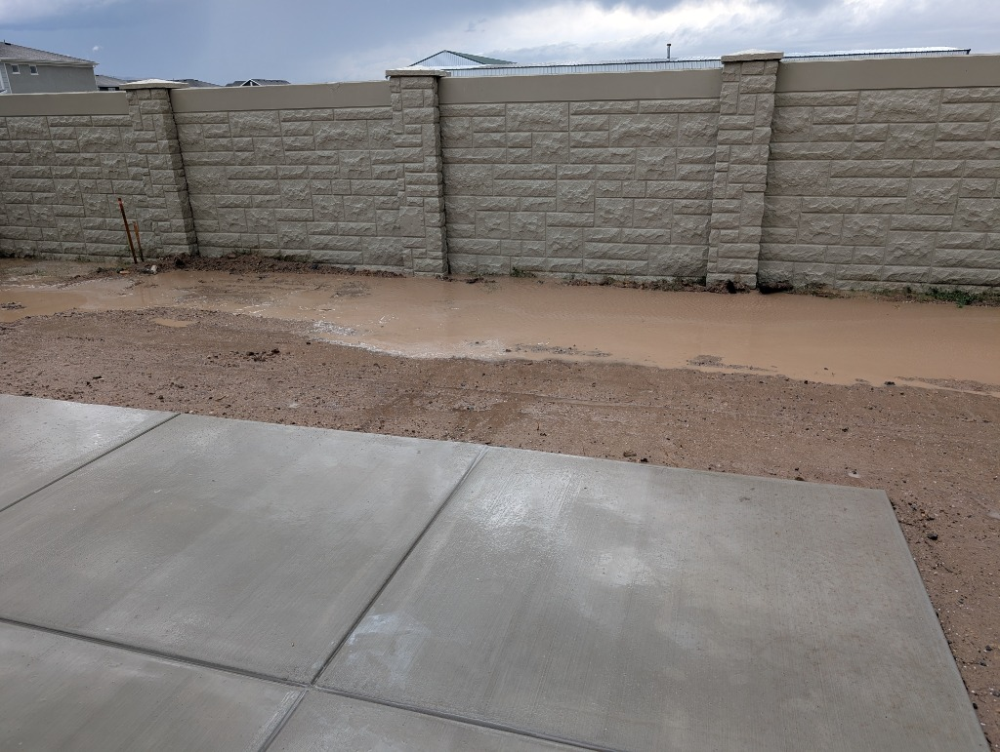
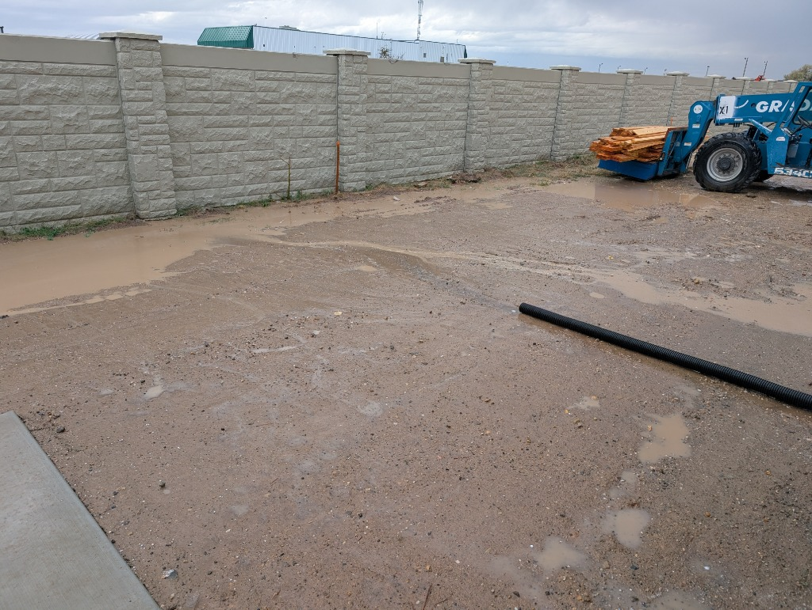
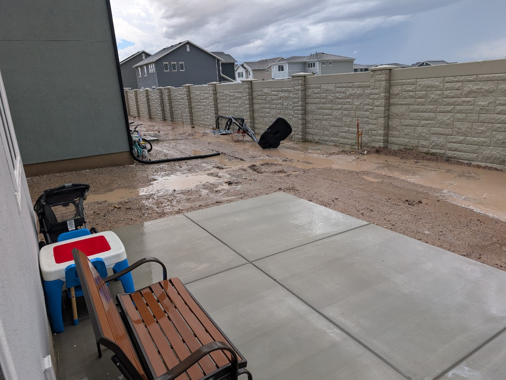

# 04 · 5-Hydrozone Sprinkler & Drip Irrigation Engineering + Stormwater Drainage

> **Single Source of Truth for Irrigation & Drainage (`Phase 2 · 2027`):** The Lot 3152 irrigation system is engineered around **5 dedicated hydrozones (+ 1 capped spare zone on a 6/8-zone smart controller)** with **100% directional perimeter placement (`28` heads)**, **true head-to-head spacing**, **matched precipitation rates (`0.40 in/hr`)**, and **0% overspray onto hardscape, patio furniture, timber awning pillars, `'Standing Ovation'` tree trunks, or the completely open AC condenser unit (`wx = 45.0'–48.0'`)**.

---

## 1. Point of Connection (POC), Backflow Prevention, Manifolds & Conduit Sleeving

1. **Point of Connection (POC) & Backflow Preventer (`wx = 51.0', wy = 8.6'`):**
   * Tee into the $3/4"\text{–}1"$ copper/PEX domestic water supply at the **North exterior hose bib (`wx = 51.0', wy = 8.6'`)** and install a **`1" Febco 765 Pressure Vacuum Breaker (PVB)`** (mounted $12"$ above the highest downstream head) with a brass isolation ball valve, union fittings, and a $3/4"$ winterization compressed-air blowout port.
2. **Smart Wi-Fi EPA WaterSense Controller (`wx = 52.5', wy = 10.2'`):**
   * **`Rachio 3 (8-Zone)`** or **`Hunter Hydrawise HPC (6/8-Zone)`** mounted inside the dry garage interior wall (`wx = 52.5', wy = 10.2'`) with `18/7` direct-bury multi-conductor thermostat wire routed through a weatherproof PVC LB conduit fitting out to the manifolds.
3. **Dual Flush Valve Manifold Boxes (`M1` & `M2`):**
   * **`Manifold Box M1` (`wx = 51.0', wy = 7.8'` — North Corridor next to POC):** Houses **Zone 2** (`1" Hunter PGV-101G`), **Zone 3** (`1" Hunter PGV-101G`), **Zone 5** (`Hunter PCZ-101-25` Drip Filter/Regulator Valve), and **Zone 6** (capped spare manifold port).
   * **`Manifold Box M2` (`wx = 28.5', wy = 7.8'` — NW House Corner):** Fed via $1"$ Schedule 40 PVC mainline inside a $2"$ sleeve; houses **Zone 1** (`1" Hunter PGV-101G`) and **Zone 4** (`Hunter PCZ-101-25` Drip Filter/Regulator Valve).
4. **Mandatory `2"` Schedule 40 PVC Conduit Sleeves Under Compacted Road Base (`Installed in 2027 Prior to 2029 Road Base`):**
   * **`Sleeve S-1` (`wx = 27.0'–52.0', wy = 7.8'`):** $25\text{ lin ft}$ of $2"$ Schedule 40 PVC under the North side compacted road base pad for the $1"$ mainline and `18/7` valve wire between `M1` and `M2`.
   * **`Sleeve S-2` (`wx = 27.0'–30.0', wy = 10.2'`):** $4\text{ lin ft}$ of $2"$ Schedule 40 PVC under the North end of the $3.0'\times 11.0'$ rear house compacted road base path.
   * **`Sleeve S-3` (`wx = 27.0'–30.0', wy = 19.5'`):** $4\text{ lin ft}$ of $2"$ Schedule 40 PVC under the South end of the $3.0'\times 11.0'$ rear house compacted road base path.

---

## 2. 5-Hydrozone Hydraulics & Runtime Summary (`12.70 GPM` Total Across All 5 Zones)

| Zone | Hydrozone Name & Microclimate | Manifold | Equipment & Nozzle Type | Head / Emitter Count | Peak Flow (`GPM`) | Precip Rate | Cycle-and-Soak Schedule (Utah Clay) |
| :--- | :--- | :---: | :--- | :---: | :---: | :---: | :--- |
| **Zone 1** | **Backyard Full-Sun Turf** (`679 sq ft`) | `M2` | `Hunter PRS40` (`PRS40-CV` check valves on low West heads `B1, B6, B8, B9, B11`) + `MP1000` / `MP800SR` (`90°` & `180°` sectors) | **15 Heads** (`B1`–`B14`) | **`5.32 GPM`** | $0.40\text{–}0.80\text{ in/hr}$ | $3\times 14\text{ min}$ cycles ($42\text{ min}$ total, $3\times/\text{wk}$ Summer) |
| **Zone 2** | **South Side `3.0'–6.0'` Shaded Corridor Turf** (`176 sq ft`, up to South house wall pavers along `wx=30–44.5'` & `wx=48.5–59.7'`, wrapping AC paver border & continuing under gate) | `M1` | `Hunter PRS40 (40 PSI)` + **`MP Side-Strip`** (`3.0'–5.75' N × 9.0' W` rectangular throw) | **4 Heads** (`S1`–`S4`) | **`0.88 GPM`** | $0.40\text{ in/hr}$ | $2\times 12\text{ min}$ cycles ($24\text{ min}$ total, $2\text{–}3\times/\text{wk}$ — $55\%$ of full-sun runtime) |
| **Zone 3** | **SE Front Yard Full-Sun Turf** (`555 sq ft`) | `M1` | `Hunter PRS40 (40 PSI)` + `MP1000` / `MP800SR` (`90°`, `135°` & `180°` sectors) | **9 Heads** (`F1`–`F9`) | **`3.49 GPM`** | $0.40\text{ in/hr}$ | $3\times 14\text{ min}$ cycles ($42\text{ min}$ total, $3\times/\text{wk}$ Summer) |
| **Zone 4** | **Perimeter Beds PC Drip** (W. `5+4` Trees, Cont. `2'` S. Bed, Norwegian Sunset Maple Ring & Porch Hyacinths) | `M2` | `Hunter PCZ-101-25` (`30 PSI` / `150 Mesh`) + $1/2"$ PC Drip Tubing & Button Emitters | `~230 lin ft` Tubing | **`1.63 GPM`** (`98 GPH`) | Deep root soak | $45\text{–}60\text{ min}$, $2\times/\text{wk}$ ($1\times/\text{wk}$ established trees) |
| **Zone 5** | **5 Raised Cedar Garden Boxes (`N1`–`N5`) Grid Drip** (`90 sq ft` growing area) | `M1` | `Hunter PCZ-101-25` (`25 PSI`) + 5 Per-Box Ball Valves + $1/4"$ Emitter Grids (`0.5 GPH @ 6"`) | **5 Box Grids** (`165 Emitters`) | **`1.38 GPM`** (`82.5 GPH`) | Vegetable root grid | $25\text{–}35\text{ min}$ daily / every other day in peak Summer |
| **Zone 6** | **Capped Spare Port & Wire** | `M1` | Capped $1"$ manifold port + spare `18/7` conductor | — | `0.00 GPM` | Future expansion | Available for future patio hanging baskets / pots |

---

## 3. Complete 28-Head Coordinate, Nozzle, Arc & Throw Schedule (`Zones 1, 2 & 3`)

All 28 turf pop-up heads sit strictly **$3"$ inside the grass along the flush Holland paver or concrete perimeter**, spraying **inward into the turf** (`0° = East (+wx)`, `90° = South (+wy)`, `180° = West (-wx)`, `270° = North (-wy)`):

| Head ID | Zone | Exact Coordinate (`wx`, `wy`) | Placement Location | Nozzle & Body (`Hunter PRS40`) | Sector Arc (`Deg`) | Throw Radius | Flow (`GPM`) | Critical Overspray Prevention & Opposing Head-to-Head Pair |
| :--- | :---: | :---: | :--- | :--- | :--- | :---: | :---: | :--- |
| **`B1`** | **Z1** | `(4.75', 10.25')` | NW Backyard Turf Corner | `MP1000-90` (`PRS40-CV` check valve) | `90° SE` (`0°..90°`) | $11.0'$ | `0.21` | Zero spray into West tree bed (`wx < 4.5'`) or North cedar boxes (`wy < 8.5'`); `PRS40-CV` prevents low-head drainage; reaches `B2` & `B6`. |
| **`B2`** | **Z1** | `(15.75', 10.25')` | N Backyard Paver Mid | `MP1000-90` (`180°`) | `180° S` (`0°..180°`) | $10.5'$ | `0.42` | Zero spray North onto cedar boxes (`N1`–`N5`); throws South to `B5` (`wy=20.25'`). |
| **`B3`** | **Z1** | `(26.25', 10.25')` | NE Backyard Turf Corner | `MP1000-90` | `90° SW` (`90°..180°`) | $10.5'$ | `0.21` | Zero spray East onto $3'\times 11'$ rear road-base path; reaches `B2` & `B4`. |
| **`B4`** | **Z1** | `(26.25', 19.75')` | Patio NE Notch Corner | `MP1000-90` | `90° NW` (`180°..270°`) | $10.0'$ | `0.21` | **Strictly sprays NW away from the $21'\times 12.5'$ patio slab & rear path**; opposes `B3` & `B5`. |
| **`B5`** | **Z1** | `(17.25', 20.25')` | Patio NW Corner (Next to Pillar `P1`) | `MP1000-90` (`180°`) | `180° W` (`90°..270°`) | $12.0'$ | `0.42` | **Sprays strictly West (`180°`) away from Patio Awning Pillar `P1` (`18.0, 20.5`) & Lounge**; reaches `B6`. |
| **`B6`** | **Z1** | `(4.75', 20.50')` | W Backyard Paver Upper-Mid | `MP1000-90` (`180°`, `PRS40-CV`) | `180° E` (`-90°..90°`) | $12.5'$ | `0.42` | Zero spray West onto `'Standing Ovation'` Serviceberry trunks; `PRS40-CV` prevents low-head drainage; throws $12.5'$ East to `B5`. |
| **`B7`** | **Z1** | `(17.25', 30.50')` | Patio W Edge Center | `MP1000-90` (`180°`) | `180° W` (`90°..270°`) | $12.5'$ | `0.42` | **Sprays strictly West (`180°`) away from L-Sectional & Fire Table**; throws $12.5'$ West to `B8` (`4.75'`). |
| **`B8`** | **Z1** | `(4.75', 30.50')` | W Backyard Paver Center | `MP1000-90` (`180°`, `PRS40-CV`) | `180° E` (`-90°..90°`) | $12.5'$ | `0.42` | Opposes `B7` across the $13.0'$ main backyard turf bay (`wx = 4.5'–17.5'`); `PRS40-CV` check valve prevents post-cycle puddling. |
| **`B9`** | **Z1** | `(4.75', 39.50')` | W Backyard Paver Lower-Mid | `MP1000-90` (`180°`, `PRS40-CV`) | `180° E` (`-90°..90°`) | $12.5'$ | `0.42` | Opposes `B10a` across the lower backyard turf bay; `PRS40-CV` check valve; overlaps `B8` & `B11`. |
| **`B10a`** | **Z1** | `(17.25', 40.75')` | Patio SW Corner West-Throw (Next to `P2`) | `MP1000-90` | `90° NW` (`180°..270°`) | $12.5'$ | `0.21` | **90° NW sector keeps 100% of water off Patio Awning Pillar `P2` (`18.0, 40.5`) and off the South fence!** |
| **`B10b`** | **Z1** | `(18.00', 41.25')` | Patio South Edge Strip | `MP800SR-90` (`180°`) | `180° S` (`0°..180°`) | $6.25'$ | `0.45` | Dedicated short-radius head spraying $6.25'$ South across the $6.5'$ South backyard bay to `B12` (`47.25'`). |
| **`B11`** | **Z1** | `(4.75', 47.25')` | SW Backyard Turf Corner | `MP1000-90` (`PRS40-CV` check valve) | `90° NE` (`-90°..0°`) | $12.0'$ | `0.21` | Zero spray into West or South beds; `PRS40-CV` prevents low-head drainage; reaches `B9`, `B10a` & `B12`. |
| **`B12`** | **Z1** | `(18.00', 47.25')` | S Backyard Paver Mid-West | `MP800SR-90` (`180°`) | `180° N` (`180°..360°`) | $6.25'$ | `0.45` | Opposes `B10b` ($6.25'$ throw stops right at the `wy = 41.0'` South patio edge—zero spray on patio!). |
| **`B13`** | **Z1** | `(29.75', 47.25')` | S Backyard Paver at House SW Corner | `MP800SR-90` (`180°`) | `180° N` (`180°..360°`) | $5.75'$ | `0.45` | Opposes `B14` across the `wy = 41.5'–47.5'` transition into the South corridor. |
| **`B14`** | **Z1** | `(29.75', 41.25')` | House SW Stucco Corner | `MP800SR-90` | `90° SW` (`90°..180°`) | $6.5'$ | `0.40` | Sprays SW away from house foundation wall; opposes `B13` & `B10b`. |
| **`S1`** | **Z2** | `(35.00', 47.25')` | South Corridor Paver Edge #1 (West of AC) | **`MP Side-Strip`** | Rect (`5.75' N × 9.0' W`) | $5.75'\times 9.0'$ | `0.22` | Irrigates the full `6.0'` wide grass section (`wx = 30.0'–44.5'`, `wy = 41.5'–47.5'`) up to the flush Holland pavers against the South house wall. |
| **`S2`** | **Z2** | `(44.00', 47.25')` | South Corridor Paver Edge #2 (Opposite AC) | **`MP Side-Strip`** | Rect (`3.00' N × 9.0' W`) | $3.00'\times 9.0'$ | `0.22` | **Stops at `wy = 44.25'` AC Paver Wrap Edge — ZERO hard-water spray ever hits the Open AC Unit (`wx = 45–48, wy = 41–44`)!** |
| **`S3`** | **Z2** | `(53.00', 47.25')` | South Corridor Paver Edge #3 (East of AC / West of Gate) | **`MP Side-Strip`** | Rect (`5.75' N × 9.0' W`) | $5.75'\times 9.0'$ | `0.22` | Irrigates the full `6.0'` wide grass section East of the AC unit (`wx = 48.5'–57.5'`, `wy = 41.5'–47.5'`) right up to the flush South house wall pavers (notched around the electric/gas/fiber conduits). |
| **`S4`** | **Z2** | `(62.00', 47.25')` | South Corridor Paver Edge #4 (East of Gate) | **`MP Side-Strip`** | Rect (`4.00' N × 9.0' W`) | $4.00'\times 9.0'$ | `0.22` | Irrigates the continuous turf directly under the `wx = 57.5'` South gate (`wx = 57.5'–66.5'`) and alongside the $2.0'$ porch-front Hyacinth bed. |
| **`F1`** | **Z3** | `(66.25', 32.75')` | Front NW Lawn Corner (Next to Hyacinths) | `MP1000-90` | `90° SE` (`0°..90°`) | $11.5'$ | `0.21` | **Sprays strictly SE into lawn — zero overhead spray into Melinda's `2.0'` Porch-Front Hyacinth Bed!** |
| **`F2`** | **Z3** | `(66.25', 43.25')` | Front W Lawn Corner (SE Porch Corner) | `MP1000-90` (`135°`) | `135° E/NE/S` (`-45°..90°`) | $11.5'$ | `0.32` | Covers the West front lawn edge while staying completely clear of the `3152` front porch & swing. |
| **`F3`** | **Z3** | `(80.75', 32.75')` | Front Walk Step-Down Corner | `MP1000-90` (`180°`) | `180° S` (`0°..180°`) | $11.5'$ | `0.42` | Sprays South from the $3.5'$ front concrete walk edge; opposes `F8` & `F9`. |
| **`F4`** | **Z3** | `(88.80', 29.25')` | North Driveway Curb Edge (`wy = 29.0'`) | `MP800SR-90` (`180°`) | `180° S` (`0°..180°`) | $7.6'$ | `0.48` | Radius tuned to $7.6'$ (`wx = 81.2'–96.4'`) so **zero water crosses onto the driveway or city sidewalk**. |
| **`F5`** | **Z3** | `(96.45', 29.25')` | NE Front Lawn Corner (Driveway/Sidewalk) | `MP1000-90` | `90° SW` (`90°..180°`) | $9.5'$ | `0.21` | Sprays SW into the $18.5'$ East lawn bay; zero overspray onto the $4.0'$ public sidewalk (`wx = 96.7'`). |
| **`F6`** | **Z3** | `(96.45', 38.25')` | East Sidewalk Mid Edge | `MP1000-90` (`180°`) | `180° W` (`90°..270°`) | $11.0'$ | `0.42` | Sprays West from the city sidewalk edge toward `F3` & `F9`. |
| **`F7`** | **Z3** | `(96.45', 47.25')` | SE Front Lawn Corner (Next to Green Box) | `MP1000-90` | `90° NW` (`180°..270°`) | $11.0'$ | `0.21` | Sprays NW into the lawn, keeping water off the green transformer box (`wx = 93.0'–96.4'`). |
| **`F8`** | **Z3** | `(77.50', 47.25')` | South Front Paver Mid-West | `MP1000-90` (`180°`) | `180° N` (`180°..360°`) | $11.0'$ | `0.59` | Throws $11.0'$ North (`wy = 47.25' → 36.25'`), staying cleanly inside the $15.0'$ West front lawn bay (`wy = 32.5'`). |
| **`F9`** | **Z3** | `(87.00', 47.25')` | South Front Paver Mid-East | `MP1000-90` (`180°`) | `180° N` (`180°..360°`) | $11.5'$ | `0.63` | Sprays North into the lawn while the Norwegian Sunset® Maple (`83.0', 39.5'`) is fed at its roots by a Zone 4 concentric PC drip ring. |

---

## 4. October 2026 Stormwater / Rain-Pooling Observations, 7 Engineering Considerations & Locked-In Drainage Plan

As documented in the three October 25, 2026 post-rain site survey photos ([`rain_pooling_01_west_wall_from_patio.jpg`](../photos_current_backyard/rain_pooling_01_west_wall_from_patio.jpg), [`rain_pooling_02_nw_downspout_and_north_trough.jpg`](../photos_current_backyard/rain_pooling_02_nw_downspout_and_north_trough.jpg), and [`rain_pooling_03_sw_downspout_and_south_trough.jpg`](../photos_current_backyard/rain_pooling_03_sw_downspout_and_south_trough.jpg)):

| Rain Photo #1 (`rain_pooling_01_west_wall_from_patio.jpg`) | Rain Photo #2 (`rain_pooling_02_nw_downspout_and_north_trough.jpg`) | Rain Photo #3 (`rain_pooling_03_sw_downspout_and_south_trough.jpg`) |
| :---: | :---: | :---: |
|  |  |  |
| **Looking West from `21'×12.5'` Patio (`wx = 17.5' → 0.0'`):** Continuous `3'–5'` wide standing water trough right inside the planned `4.0'` West Wall Bed (`wx = 0.0'–4.5'`). Note wooden builder grade stakes at `wy ≈ 11'`. | **Looking NW Across Backyard (`wx = 30' → 0', wy = 20' → -10'`):** Black `4"` corrugated flex pipe from the NW house downspout (`wx = 30', wy = 9'`) dumps roof runoff straight across compacted clay into the West wall trough. | **Looking SW from Patio (`wx = 30' → 0', wy = 25' → 50'`):** Black `4"` corrugated flex pipe from the SW house downspout (`wx = 30', wy = 41'`) discharges roof water toward the SW patio corner and West wall. |

### 4.1 Observed Site Condition & Root Causes
1. **Precast Wall Dam Effect + Settled Footing Backfill Trench (`wx = 0.0'–4.5'`):** The builder's rough foundation grading slopes Westward away from the slab-on-grade house (`wx = 30.0'`) and concrete patio (`wx = 17.5'`) toward the rear property line. Where the `50.0'` precast concrete wall (`wx = 0.0'`) and its `10.0' O.C.` column footings were excavated, the backfill settled into a continuous low trough right inside the planned `4.0'` Western Wall Bed (`wx = 0.0'–4.5'`).
2. **Both Rear Roof Downspouts (`NW` at `wx = 30.0', wy = 9.0'` & `SW` at `wx = 30.0', wy = 41.0'`) Discharge Westward Into the Backyard:** Temporary black $4"$ corrugated flex pipes attached to the NW and SW rear corner downspouts discharge concentrated roof runoff directly Westward across the bare clay dirt into this West-wall trough.
3. **Equipment-Compacted Native Clay Sub-Grade:** Heavy telehandler equipment traffic compacted the native alkaline clay into an impermeable hardpan that retains standing water for 24–72 hours.

### 4.2 All 7 Engineering Considerations & Locked-In Master Plan Mitigations

| # | Engineering Consideration | Impact on Lot 3152 Master Plan | Status in Master Plan |
| :--- | :--- | :--- | :--- |
| **1** | **Crown the `4.0'` West Wall Bed (`+3" to +4"`) & Elevate Tree Root Flares (`+2" to +3"`)** | Upright Junipers (`J1`–`J4`), Russian Sage, Lavender, and Catmint suffer fatal *Phytophthora* root rot if planted in a waterlogged clay trench; `'Standing Ovation'` Serviceberries (`S1`–`S5`) also perform best with aerated root crowns. Backfilling the settled `wx = 0.0'` trench and crowning the `4.0'` bed `+3"–4"` above the `wx = 4.0'–4.5'` paver strip sheds surface water East into the turf edge. | **✅ LOCKED IN (`2027 Phase 2` Topsoil Grading & `2028 Phase 3` Planting)** |
| **2** | **Bury `4"` Smooth-Wall PVC (`SDR-35` / `Sch 40`) Downspout Drain Lines Sloped East to the Street + `2030` Awning Gutter Stub-Out** | Replaces the two temporary black corrugated flex pipes (`NW` at `wx=30', wy=9'` and `SW` at `wx=30', wy=41'`) with `~140 lin ft` of buried `4"` smooth-wall rigid PVC lines sloped East (`1/8"–1/4"` per ft) down the North and South side yards to pop-up emitters near the front sidewalk (`wx ≈ 95'`). Includes a **capped `4"` cleanout wye at the NW patio corner (`wx=18.0', wy=20.5'`)** so the **2030 Phase 5 Solid-Roof Patio Awning (`262.5 sq ft`)** front gutter downspout drops straight underground! *(Never bury thin black corrugated pipe—it crushes under the 2029 North Road Base Pad and silts up).* | **✅ LOCKED IN (`2027 Phase 2` · `+$280 DIY` / `+$650 Pro` + `2030 Phase 5` Awning Tie-In)** |
| **3** | **Install `2×` `9"×9"` Low-Point Lawn Catch Basins Along the West Swale Edge (`wx = 4.5', wy = 12.0' & 38.0'`)** | With the `4.0'` West bed crowned `+3"–4"`, heavy cloudburst runoff collects along the shallow turf swale just East of the Holland paver strip (`wx = 4.5'–6.5'`). Two flush `9"×9"` grated catch basins at `wy = 12.0'` (North) and `wy = 38.0'` (South) tie directly into the buried `4"` PVC downspout drain pipes to evacuate severe storm ponding out to the street. | **✅ LOCKED IN (`2027 Phase 2` · Included in `$280 DIY` Drainage Line Item)** |
| **4** | **Deepen the West Wall Flush Holland Paver Trench to `6"` with Non-Woven Geotextile Separation Fabric (`wx = 4.0'–4.5'`)** | Saturated clay under a standard `4"` paver trench pumps mud upward into the gravel base and causes winter freeze-thaw rollercoaster heaving. Excavating `6"` deep along the `50.0'` West run, wrapping with commercial non-woven geotextile fabric, and compacting `3"–4"` of `3/4"-minus` road base + `1"` sand keeps the mower strip dead-flat year-round. | **✅ LOCKED IN (`2027 Phase 2` Flush Paver Mow Strip Spec)** |
| **5** | **Use `Hunter PRS40-CV` (Built-In Check Valve) Sprinkler Bodies on the Low West Perimeter Heads (`B1`, `B6`, `B8`, `B9`, `B11`)** | Because the backyard slopes down from the patio (`wx = 17.5'`) to the West paver strip (`wx = 4.75'`), standard spray bodies drain all remaining lateral pipe water out of the lowest West heads after every cycle. Ordering `PRS40-CV` bodies (`~$1.50/head` difference, holds back `14'` of head) eliminates post-cycle puddling along the West bed. | **✅ LOCKED IN (`2027 Phase 2` Zone 1 Sprinkler Schedule)** |
| **6** | **Maintain a `2"` Bottom-Rail Drainage Gap Under the South (`2026`) & North (`2027`) Vinyl Fences + Builder Warranty Grading Check (`2026`)** | Leaving a `2"` gap beneath the bottom vinyl fence rail near the West wall (`wx = 0.0'–6.0'`) prevents the fence from damming the N–S lot-line swale or heaving in winter ice. Also check the **1-year builder warranty / rough-grade certification** now while wooden grade stakes are still in place (Photo #1) to have the builder fill the settled wall trench at `$0` cost. | **✅ LOCKED IN (`2026 Phase 1` & `2027 Phase 2` Fence Specs · `$0`)** |
| **7** | **Protect the `50.0'` Precast Concrete Wall from Efflorescence & Freeze-Thaw Spalling (`wx = 0.0'`)** | Standing water against the bottom of the precast wall wicks upward into the concrete panels and columns, leaving white salt deposits (efflorescence) and flaking the textured stone surface during winter freezes. Crowning the bed away from the wall and draining the trough resolves this completely. | **✅ LOCKED IN (Achieved via Crowned Bed + Catch Basins)** |

